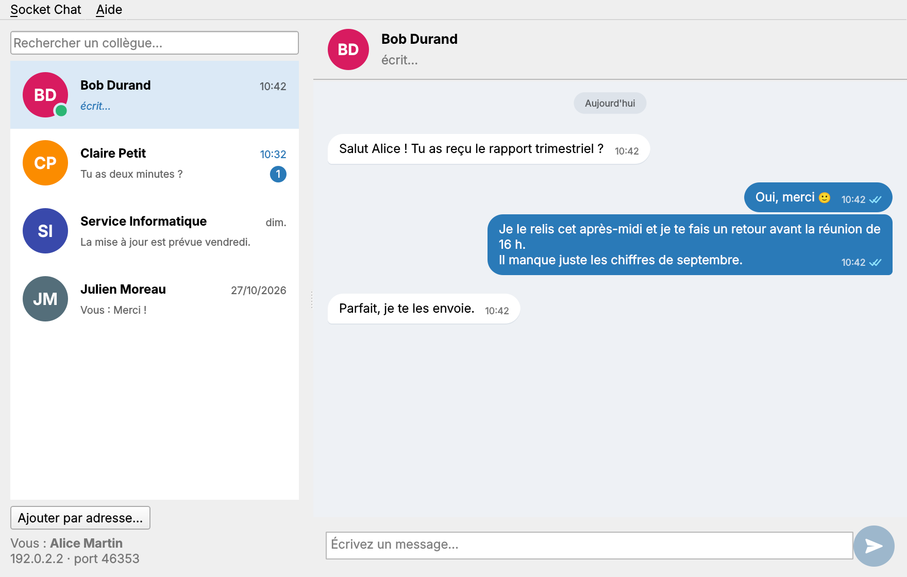

# Socket Chat

Messagerie instantanée **de poste à poste** pour le réseau interne, sans serveur
central :

- les collègues qui ont Socket Chat ouvert sur le même réseau **apparaissent tout seuls** :
  un clic et on écrit ;
- **plusieurs conversations** en parallèle, avec un **historique conservé** sur le poste ;
- messages en **bulles**, indications **« écrit… »**, accusés **✓ envoyé, ✓✓ remis,
  ✓✓ bleu lu** ;
- un message écrit à un collègue absent lui est **remis à son retour** ;
- **notifications** et compteur de non-lus dans la zone de notification, où
  l'application reste active quand on ferme la fenêtre.

Fonctionne sous **Windows** et **Linux** (Python ≥ 3.12, Qt 6 via PySide6), en thème
clair ou sombre selon le système.

| Thème clair | Thème sombre |
|---|---|
|  |  |

## Installation

### Windows

1. Récupérer `socket-chat-<version>-windows-setup.exe` (onglet *Releases* du dépôt,
   ou artefact du workflow **Release**).
2. Lancer l'installeur. Par défaut, l'installation se fait **pour l'utilisateur courant
   et sans droits administrateur**. Elle crée un raccourci dans le menu Démarrer et un
   programme de désinstallation.
3. Au premier lancement, Windows peut demander d'autoriser l'application dans le
   pare-feu : accepter pour les réseaux **privés / de domaine**. Si l'installeur est
   lancé en mode administrateur, une option crée cette règle directement (elle couvre
   la messagerie et la détection des collègues).

> Déploiement silencieux (GPO, SCCM, Intune…) :
> `socket-chat-<version>-windows-setup.exe /VERYSILENT /SUPPRESSMSGBOXES /ALLUSERS /TASKS="firewall"`

### Linux

```bash
tar -xzf socket-chat-<version>-linux-x86_64.tar.gz
```

```bash
./socket-chat-<version>-linux-x86_64/install.sh
```

L'application est installée dans `~/.local/share/socket-chat`, avec une entrée dans le
menu des applications et la commande `socket-chat`. Pour la désinstaller :
`install.sh --uninstall`.

L'archive est construite sur Ubuntu 22.04 et fonctionne sur les distributions
équivalentes ou plus récentes (Debian 12, RHEL 9, Fedora…).

### Avec Python (toutes plates-formes)

Si Python est déjà disponible sur le poste :

```bash
pipx install git+https://github.com/andoajpr2/socket-python.git
```

ou, sans pipx, `pip install --user <url ou chemin du dépôt>`. Cela fournit la commande
`socket-chat`.

## Utilisation

| Action | Comment |
|---|---|
| Discuter avec un collègue | Cliquer sur son nom dans la liste (point vert = en ligne) |
| Collègue d'un autre réseau (VPN, autre site) | **Ajouter par adresse…** (`Ctrl+N`) : saisir son adresse, affichée en bas de *sa* liste de contacts |
| Rechercher un collègue | `Ctrl+F` |
| Envoyer / aller à la ligne | `Entrée` / `Maj+Entrée` |
| Copier un message | Clic droit sur la bulle |
| Changer de nom, de port, le comportement à la fermeture | **Socket Chat › Préférences…** |
| Quitter vraiment | **Socket Chat › Quitter** (`Ctrl+Q`) ou clic droit sur l'icône de notification |

- Au premier lancement, l'application demande le nom affiché chez vos collègues.
- Fermer la fenêtre laisse Socket Chat actif dans la zone de notification (désactivable
  dans les préférences) : les nouveaux messages déclenchent une notification. Un clic
  dessus ouvre la conversation.
- Relancer Socket Chat alors qu'il tourne déjà réaffiche simplement la fenêtre.
- Un message envoyé à un collègue hors ligne est conservé (🕓) et lui est remis
  automatiquement dès qu'il revient.

### Réseau

| Port | Rôle |
|---|---|
| **12800/TCP** | messages (modifiable dans les préférences) |
| **12801/UDP** | détection des collègues (annonces diffusées sur le réseau local) |

La détection utilise la diffusion (broadcast) : elle ne franchit pas les routeurs et peut
être filtrée sur certains réseaux. Dans ce cas, l'ajout par adresse fonctionne toujours.

Options en ligne de commande : `socket-chat --version`, `socket-chat --debug`
(journal détaillé).

### Fichiers sur le poste

| | Windows | Linux |
|---|---|---|
| Préférences | registre `HKCU\Software\SocketChat` | `~/.config/SocketChat/SocketChat.conf` |
| Historique | `%LOCALAPPDATA%\SocketChat\SocketChat\history.sqlite3` | `~/.local/share/SocketChat/SocketChat/history.sqlite3` |
| Journal | `%LOCALAPPDATA%\SocketChat\SocketChat\socket-chat.log` | `~/.local/share/SocketChat/SocketChat/socket-chat.log` |

## Sécurité

Conçu pour un **réseau interne de confiance** :

- Les échanges **ne sont pas chiffrés** et les correspondants ne sont pas authentifiés
  (le nom et l'identifiant annoncés sont déclaratifs). Ne pas l'utiliser pour des
  informations confidentielles ni l'exposer sur Internet.
- L'historique est stocké en clair dans le profil de l'utilisateur.
- Les données reçues sont validées : taille limitée (10 000 caractères par message,
  64 Kio par trame), JSON strict, texte affiché sans interprétation HTML. Toute donnée
  invalide coupe la connexion.

## Développement

```bash
python -m venv .venv
```

```bash
source .venv/bin/activate      # Windows : .venv\Scripts\activate
```

```bash
pip install -e ".[dev]"
```

```bash
pytest && ruff check . && ruff format --check .
```

Sous Linux sans affichage (serveur, CI), les tests utilisent `QT_QPA_PLATFORM=offscreen`
et nécessitent les bibliothèques système `libegl1 libxkbcommon0 libfontconfig1 libdbus-1-3`.

### Organisation du code

```
src/socket_chat/
├── app.py            point d'entrée : instance unique, journal, assemblage
├── protocol.py       trames TCP (JSON Lines) et annonces UDP : pur Python, sans Qt
├── store.py          historique SQLite (contacts, messages, états) : pur Python
├── network.py        PeerConnection : une connexion TCP avec présentation mutuelle
├── messenger.py      Messenger : écoute, une connexion par contact, file d'envoi, accusés
├── discovery.py      Discovery : annonces UDP et détection des collègues
├── settings.py       préférences utilisateur (QSettings)
├── ui/               fenêtre, modèles, délégués (bulles), zone de notification
└── resources/        icônes (SVG ; PNG/ICO générés par scripts/make_icons.py)
```

Tout repose sur la boucle d'événements Qt : aucun thread, les signaux de `Messenger`
sont reliés directement à l'interface.

### Protocole (version 2)

Une trame TCP est un objet JSON UTF-8 sur une ligne, terminé par `\n` :

```json
{"type": "hello", "version": 2, "id": "<uuid>", "name": "Alice", "port": 12800}
{"type": "chat", "id": "<uuid du message>", "text": "Bonjour\nça va ?"}
{"type": "ack", "id": "<uuid du message>", "status": "delivered"}
{"type": "typing", "active": true}
{"type": "bye", "reason": ""}
```

Chaque pair envoie `hello` dès la connexion et doit recevoir celui de l'autre sous
10 secondes. Les annonces UDP (`announce`, `leave`) portent la même version. Une version
différente est refusée : tous les postes doivent passer à la même version majeure
(la 3.x ne communique pas avec la 2.x).

### Publier une version

1. Mettre à jour `__version__` dans `src/socket_chat/__init__.py`, les numéros de
   `packaging/windows/version_info.txt` et `CHANGELOG.md`.
2. Créer et pousser un tag `vX.Y.Z` : le workflow **Release** construit l'installeur
   Windows et l'archive Linux, puis les joint à une Release GitHub.

Pour construire localement sur la plate-forme courante : `pip install ".[build]"` puis
`python scripts/build.py` (sous Windows, l'installeur n'est produit que si
[Inno Setup 6](https://jrsoftware.org/isinfo.php) est installé ; sinon seul le dossier
`dist/socket-chat` est créé).
