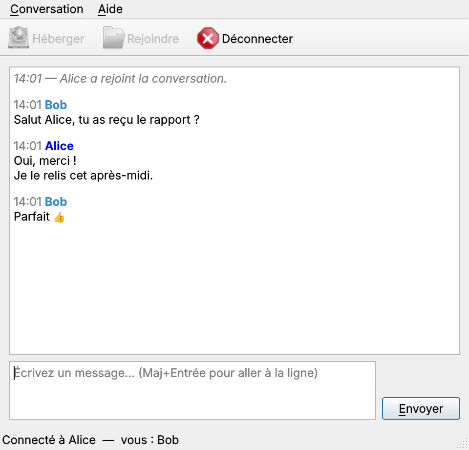

# Socket Chat

Messagerie instantanée **de poste à poste** pour le réseau interne : un collègue
héberge la conversation, l'autre la rejoint avec l'adresse IP ou le nom du poste.
Pas de serveur central, rien n'est stocké.

Fonctionne sous **Windows** et **Linux** (Python ≥ 3.12, Qt 6 via PySide6).



## Installation

### Windows

1. Récupérer `socket-chat-<version>-windows-setup.exe` (onglet *Releases* du dépôt,
   ou artefact du workflow **Release**).
2. Lancer l'installeur. Par défaut, l'installation se fait **pour l'utilisateur courant
   et sans droits administrateur**. Elle crée un raccourci dans le menu Démarrer et un
   programme de désinstallation.
3. Au premier « Héberger », Windows peut demander d'autoriser l'application dans le
   pare-feu : accepter pour les réseaux **privés / de domaine**. Si l'installeur est
   lancé en mode administrateur, une option permet de créer cette règle directement.

> Déploiement silencieux (GPO, SCCM, Intune…) :
> `socket-chat-<version>-windows-setup.exe /VERYSILENT /SUPPRESSMSGBOXES /ALLUSERS /TASKS="firewall"`

### Linux

```bash
tar -xzf socket-chat-<version>-linux-x86_64.tar.gz
```

```bash
./socket-chat-<version>-linux-x86_64/install.sh
```

L'application est installée dans `~/.local/share/socket-chat`, avec une entrée dans le
menu des applications et la commande `socket-chat`. Pour la désinstaller :
`install.sh --uninstall`.

L'archive est construite sur Ubuntu 22.04 et fonctionne sur les distributions
équivalentes ou plus récentes (Debian 12, RHEL 9, Fedora…).

### Avec Python (toutes plates-formes)

Si Python est déjà disponible sur le poste :

```bash
pipx install git+https://github.com/andoajpr2/socket-python.git
```

ou, sans pipx, `pip install --user <url ou chemin du dépôt>`. Cela fournit la commande
`socket-chat`.

## Utilisation

| Action | Menu / raccourci |
|---|---|
| Attendre un collègue sur ce poste | **Héberger** (`Ctrl+H`) : l'adresse à communiquer s'affiche dans la barre d'état |
| Se connecter au poste d'un collègue | **Rejoindre…** (`Ctrl+J`) : saisir son adresse (les dernières sont mémorisées) |
| Terminer la conversation | **Déconnecter** (`Ctrl+D`) |
| Envoyer / aller à la ligne | `Entrée` / `Maj+Entrée` |
| Changer de nom ou de port | **Conversation › Préférences…** |

- Au premier lancement, l'application demande le nom affiché chez vos correspondants.
- L'hôte n'accepte qu'un correspondant à la fois. Quand celui-ci part, l'hôte se remet
  automatiquement en écoute.
- Port par défaut : **12800/TCP**. Il doit être le même des deux côtés et autorisé par
  le pare-feu du poste qui héberge.

Options en ligne de commande : `socket-chat --version`, `socket-chat --debug`
(journal détaillé).

### Fichiers sur le poste

| | Windows | Linux |
|---|---|---|
| Préférences | registre `HKCU\Software\SocketChat` | `~/.config/SocketChat/SocketChat.conf` |
| Journal | `%LOCALAPPDATA%\SocketChat\SocketChat\socket-chat.log` | `~/.local/share/SocketChat/SocketChat/socket-chat.log` |

## Sécurité

Conçu pour un **réseau interne de confiance** :

- Les échanges **ne sont pas chiffrés** et les correspondants ne sont pas authentifiés
  (le nom affiché est déclaratif). Ne pas l'utiliser pour des informations
  confidentielles ni l'exposer sur Internet.
- Les données reçues sont validées : taille limitée (10 000 caractères par message,
  64 Kio par trame), JSON strict, texte affiché sans interprétation HTML. Toute donnée
  invalide coupe la connexion.

## Développement

```bash
python -m venv .venv
```

```bash
source .venv/bin/activate      # Windows : .venv\Scripts\activate
```

```bash
pip install -e ".[dev]"
```

```bash
pytest && ruff check . && ruff format --check .
```

Sous Linux sans affichage (serveur, CI), les tests utilisent `QT_QPA_PLATFORM=offscreen`
et nécessitent les bibliothèques système `libegl1 libxkbcommon0 libfontconfig1 libdbus-1-3`.

### Organisation du code

```
src/socket_chat/
├── app.py            point d'entrée (arguments, journalisation, QApplication)
├── protocol.py       format des trames (JSON Lines) : pur Python, sans Qt
├── network.py        PeerConnection (une connexion) et ChatSession (hôte / invité)
├── settings.py       préférences utilisateur (QSettings)
├── ui/               fenêtre principale et boîtes de dialogue
└── resources/        icône (SVG source + PNG/ICO générés par scripts/make_icons.py)
```

Le réseau repose sur la boucle d'événements Qt (`QTcpServer`/`QTcpSocket`) : aucun
thread, les signaux de `ChatSession` sont reliés directement à l'interface.

### Protocole

Une trame est un objet JSON UTF-8 sur une ligne, terminé par `\n` :

```json
{"type": "hello", "version": 1, "name": "Alice"}
{"type": "chat", "text": "Bonjour\nça va ?"}
{"type": "bye", "reason": ""}
```

Chaque pair envoie `hello` dès la connexion et doit recevoir celui de l'autre sous
10 secondes. Une version différente coupe la connexion : les postes doivent utiliser la
même version majeure de l'application.

### Publier une version

1. Mettre à jour `__version__` dans `src/socket_chat/__init__.py`, les numéros de
   `packaging/windows/version_info.txt` et `CHANGELOG.md`.
2. Créer et pousser un tag `vX.Y.Z` : le workflow **Release** construit l'installeur
   Windows et l'archive Linux, puis les joint à une Release GitHub.

Pour construire localement sur la plate-forme courante : `pip install ".[build]"` puis
`python scripts/build.py` (sous Windows, l'installeur n'est produit que si
[Inno Setup 6](https://jrsoftware.org/isinfo.php) est installé ; sinon seul le dossier
`dist/socket-chat` est créé).
