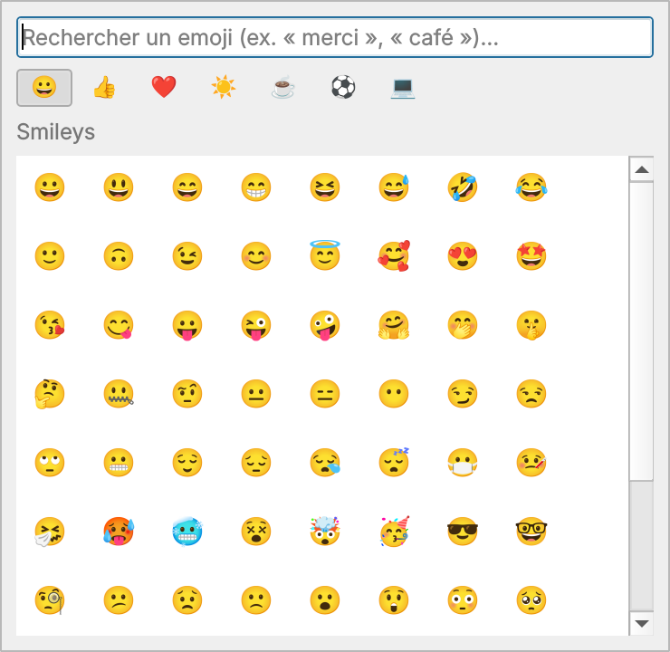
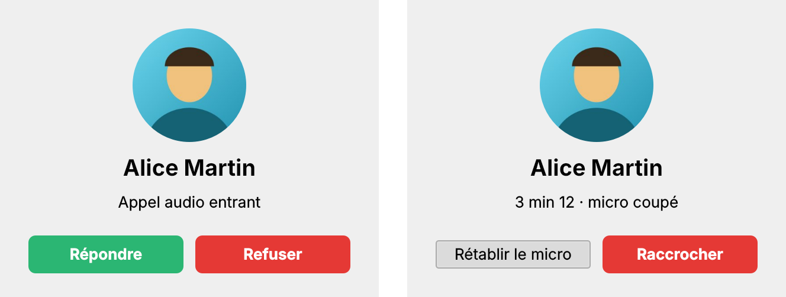
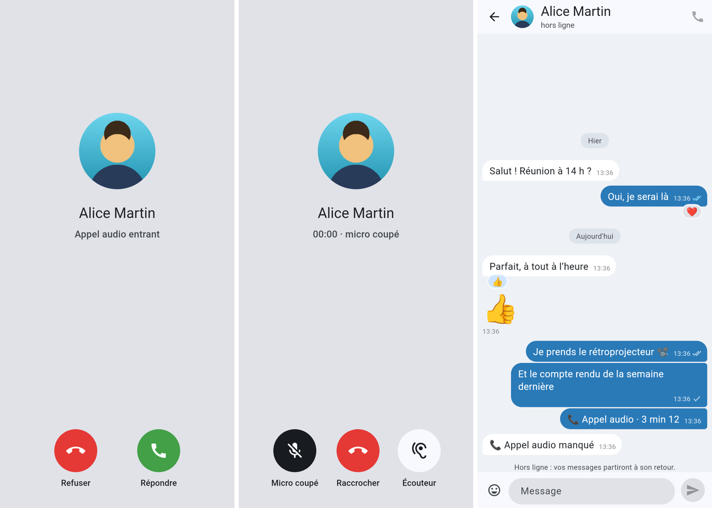
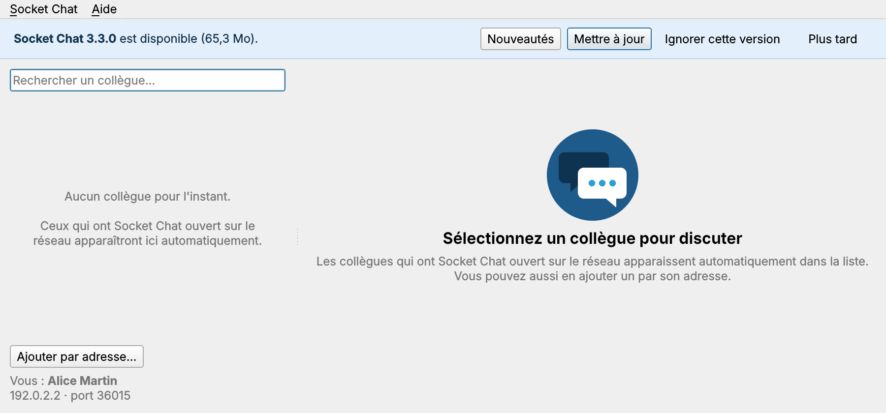

# Socket Chat

Messagerie instantanée **de poste à poste** pour le réseau interne, sans serveur
central :

- les collègues qui ont Socket Chat ouvert sur le même réseau **apparaissent tout seuls** :
  un clic et on écrit ;
- **plusieurs conversations** en parallèle, avec un **historique conservé** sur le poste ;
- messages en **bulles**, indications **« écrit… »**, accusés **✓ envoyé, ✓✓ remis,
  ✓✓ bleu lu** ;
- un message écrit à un collègue absent lui est **remis à son retour** ;
- **photo de profil** : chacun choisit la sienne, ses collègues la voient à la place
  des initiales ;
- **emojis** (sélecteur avec recherche, `:)` → 🙂) et **réactions** sur les messages
  (👍 ❤️ 😂…) ;
- **envoi de fichiers et d'images** (bouton 📎, glisser-déposer, Ctrl+V d'une capture) :
  le destinataire voit un aperçu et accepte ou refuse ;
- **appels audio et vidéo** entre PC et téléphones (boutons 📞 et 🎥) : son et image
  directs d'un appareil à l'autre, avec annulation d'écho et réduction de bruit ;
- **notifications** et compteur de non-lus dans la zone de notification, où
  l'application reste active quand on ferme la fenêtre.

Fonctionne sous **Windows** et **Linux** (Python ≥ 3.12, Qt 6 via PySide6), en thème
clair ou sombre selon le système.

| Thème clair | Thème sombre |
|---|---|
|  |  |

<p align="center"></p>

<p align="center"></p>

<p align="center"></p>

**Nouveau : application Android** (en test, voir [Android](#android-en-test)). Un téléphone
sur le Wi-Fi de l'entreprise converse avec les postes Windows et Linux.

<p align="center">
  
  
  
</p>

## Installation

### Windows

1. Récupérer `socket-chat-<version>-windows-setup.exe` (onglet *Releases* du dépôt,
   ou artefact du workflow **Release**).
2. Lancer l'installeur. Par défaut, l'installation se fait **pour l'utilisateur courant
   et sans droits administrateur**. Elle crée un raccourci dans le menu Démarrer et un
   programme de désinstallation.
3. Au premier lancement, Windows peut demander d'autoriser l'application dans le
   pare-feu : accepter pour les réseaux **privés / de domaine**. Au premier appel, la
   même demande peut apparaître pour **QtWebEngineProcess** (le moteur des appels) :
   l'accepter aussi, sinon le son ne passe pas. Si l'installeur est lancé en mode
   administrateur, une option crée ces règles directement (messagerie, détection des
   collègues et appels).

> Déploiement silencieux (GPO, SCCM, Intune…) :
> `socket-chat-<version>-windows-setup.exe /VERYSILENT /SUPPRESSMSGBOXES /ALLUSERS /TASKS="firewall"`

### Linux

```bash
tar -xzf socket-chat-<version>-linux-x86_64.tar.gz
```

```bash
./socket-chat-<version>-linux-x86_64/install.sh
```

L'application est installée dans `~/.local/share/socket-chat`, avec une entrée dans le
menu des applications et la commande `socket-chat`. Pour la désinstaller :
`install.sh --uninstall`.

L'archive est construite sur Ubuntu 22.04 et fonctionne sur les distributions
équivalentes ou plus récentes (Debian 12, RHEL 9, Fedora…).

Les appels utilisent le moteur de Chrome (Qt WebEngine), qui a besoin de bibliothèques
présentes sur tout bureau Linux courant (`libnss3`, `libasound2`, `libxkbfile1`,
`libxcomposite1`, `libxdamage1`, `libxrandr2`, `libxtst6`, `libgbm1`). Sur un poste
minimal, si le bouton 📞 n'aboutit pas, les installer avec le gestionnaire de paquets.

### Avec Python (toutes plates-formes)

Si Python est déjà disponible sur le poste :

```bash
pipx install git+https://github.com/andoajpr2/socket-python.git
```

ou, sans pipx, `pip install --user <url ou chemin du dépôt>`. Cela fournit la commande
`socket-chat`.

### Android (en test)

L'application Android parle le même protocole que les postes : pas de serveur, le
téléphone doit simplement être sur **le même réseau** (le Wi-Fi de l'entreprise).

1. Sur le téléphone, ouvrir la page **Releases** (dépôt public des installeurs, ou ce
   dépôt) et télécharger, pour la dernière version :
   - `socket-chat-X.Y.Z-android-arm64-v8a.apk` : presque tous les téléphones récents
     (environ trois fois plus léger) ;
   - ou `socket-chat-X.Y.Z-android.apk` : tous les téléphones, en cas de doute ou si le
     premier refuse de s'installer (« application incompatible »).

   Ensuite, la mise à jour intégrée choisit d'elle-même le fichier le plus léger qui
   convient au téléphone.
2. L'ouvrir. Android demande d'autoriser l'installation depuis cette source
   (navigateur ou gestionnaire de fichiers) : c'est normal pour une application hors
   Play Store.
3. Au premier lancement, saisir son nom : les collègues du réseau apparaissent.

**Mises à jour** : à partir de la 3.5, l'application vérifie elle-même s'il existe une
nouvelle version (au démarrage, au retour dans l'application, ou depuis Préférences ›
Rechercher une mise à jour) et l'annonce par un bandeau : **Mettre à jour** télécharge
l'APK, vérifie taille et empreinte SHA-256, puis ouvre l'installation, qu'Android fait
toujours confirmer. La première fois, Android demande aussi d'autoriser Socket Chat à
installer des applications : l'écran s'ouvre tout seul, il suffit d'activer l'option
puis de revenir. Pour passer d'une version antérieure à la 3.5, installer une dernière
fois l'APK à la main, par-dessus : l'historique est conservé. **Si vous aviez installé un APK d'essai** (artefact
`socket-chat-android-test` de GitHub Actions, avant la 3.3.1), désinstallez-le une
fois : il était signé avec une autre clé et Android refuse de le remplacer.

Déjà disponible : détection des collègues, ajout par adresse, conversations, coches,
« écrit… », emojis et réactions (appui long sur une bulle), messages hors ligne remis
plus tard, photo de profil, **appels audio et vidéo** avec les PC et les autres
téléphones (boutons 📞 et 🎥 de la conversation ; Android demande l'accès au micro, et
à la caméra, au premier appel). En vidéo, l'image du correspondant occupe l'écran, la
sienne s'affiche en incrustation ; boutons micro, caméra, retourner (caméra avant ou
arrière) et raccrocher. Le haut-parleur est activé d'office en vidéo.
Une offre de fichier venant d'un PC s'affiche et peut être refusée.

<p align="center"></p>

**Joignable application fermée** (à partir de la 3.7) : Socket Chat reste actif en
arrière-plan, même après un redémarrage du téléphone. Une notification discrète et
permanente l'indique (Android l'exige). Les nouveaux messages et les appels manqués
arrivent en notification, un par conversation ; un toucher ouvre la conversation. Un
appel entrant fait sonner et vibrer le téléphone selon son mode (normal, vibreur,
silencieux) et s'affiche en plein écran, même verrouillé, avec **Répondre** et
**Refuser**. Réglage : Préférences › **Rester joignable** (activé par défaut).

Au premier lancement de la 3.7, Android demande d'autoriser les **notifications** :
accepter. Les Préférences signalent ensuite ce qui manque encore, avec un bouton vers le
bon réglage d'Android :

- **Appels sur l'écran verrouillé** (Android 14 et plus) : autoriser Socket Chat à
  afficher les appels en plein écran ;
- **Optimisation de la batterie** : certains fabricants (Xiaomi, Huawei, Samsung,
  Oppo…) arrêtent les applications en arrière-plan ; exclure Socket Chat de
  l'optimisation. La consommation reste très faible : l'application attend simplement
  sur le réseau.

Pas encore : réception et envoi de fichiers et de photos.

Limites à connaître :

- « Rester joignable » désactivé, l'application ne reçoit messages et appels que
  lorsqu'elle est ouverte : les messages attendent sur le poste de l'expéditeur, un
  appel aboutit à « Pas de réponse ».
- Hors du réseau de l'entreprise, Socket Chat reste actif mais ne joint personne ; il
  retrouve les collègues au retour sur le Wi-Fi.
- Certains réseaux Wi-Fi d'entreprise **isolent les appareils entre eux** (« isolation
  des clients ») : ni la détection ni les connexions ne passent alors. Ce réglage relève
  du service informatique.
- Si un collègue n'apparaît pas tout seul, l'ajouter par son adresse : elle est affichée
  dans les Préférences du téléphone et en bas de la liste des contacts sur PC.

### Mettre à jour

À partir de la 3.2, **Socket Chat se met à jour tout seul** : un bandeau annonce la
nouvelle version, et un clic sur **Mettre à jour** la télécharge, vérifie son empreinte
SHA-256, l'installe et relance l'application. **Nouveautés** affiche les changements,
**Plus tard** la reproposera, **Ignorer cette version** la masque. Menu
**Aide › Rechercher des mises à jour** pour vérifier à la demande, ou
`socket-chat --update` pour vérifier et installer sans rien demander (scripts
d'administration).



Pour passer d'une version **antérieure à la 3.2** (ou sans mise à jour automatique),
il suffit d'**installer la nouvelle version par-dessus l'ancienne**, sans désinstaller :

| Installation d'origine | Mise à jour |
|---|---|
| Windows (installeur) | Lancer le nouveau `socket-chat-<version>-windows-setup.exe` (même mode : utilisateur ou tous les utilisateurs). Si Socket Chat est ouvert, même caché dans la zone de notification, l'installeur le ferme lui-même. |
| Linux (archive) | Extraire la nouvelle archive et relancer son `install.sh` : l'instance ouverte est arrêtée, puis remplacée. |
| pipx | `pipx install --force git+https://github.com/andoajpr2/socket-python.git` (quitter Socket Chat avant). |

Le nom, le port, l'identifiant et l'**historique des conversations sont conservés** :
ils sont stockés dans le profil de l'utilisateur, pas avec le programme. L'historique est
converti automatiquement si le format change.

> Après une mise à jour qui change la version du protocole (indiqué dans le
> [journal des modifications](CHANGELOG.md), par exemple 3.0 → 3.1), **tous les postes
> doivent être mis à jour** : les versions différentes ne communiquent pas entre elles.

### Mise à jour automatique : mise en place (une seule fois)

Le code est dans un dépôt **privé**, que les postes ne peuvent pas lire. Les installeurs
sont donc publiés dans un **second dépôt public** qui ne contient qu'eux :

1. Créer le dépôt **public** `andoajpr2/socket-chat-releases` (vide, avec un README).
2. Créer un jeton GitHub *fine-grained* (Settings › Developer settings › Personal access
   tokens) limité à ce dépôt, avec la permission **Contents : Read and write**.
3. Dans ce dépôt-ci, Settings › Secrets and variables › Actions : ajouter ce jeton sous
   le nom **`RELEASES_TOKEN`**.

À chaque tag `vX.Y.Z`, le workflow **Release** publie alors aussi les installeurs et le
manifeste `latest.json` dans le dépôt public. Sans le secret, la publication publique est
simplement ignorée (avertissement dans le workflow).

Les postes lisent
`https://github.com/andoajpr2/socket-chat-releases/releases/latest/download/latest.json`
(Internet nécessaire ; le proxy système est utilisé).

**Pour l'administrateur** : ces réglages se placent dans les préférences de l'utilisateur
ou, pour tout le monde, dans `HKEY_LOCAL_MACHINE\Software\SocketChat\SocketChat`
(Windows) ou `/etc/xdg/SocketChat/SocketChat.conf` (Linux) :

| Clé | Effet |
|---|---|
| `update/url` | Autre source : adresse HTTPS, dossier réseau (`\\serveur\logiciels\socket-chat`) ou chemin local contenant `latest.json` et les installeurs |
| `update/enabled` | `false` pour désactiver la mise à jour automatique |

Pour un dossier réseau, y copier les fichiers de la Release (installeurs et
`latest.json`) tels quels.

## Utilisation

| Action | Comment |
|---|---|
| Discuter avec un collègue | Cliquer sur son nom dans la liste (point vert = en ligne) |
| Collègue d'un autre réseau (VPN, autre site) | **Ajouter par adresse…** (`Ctrl+N`) : saisir son adresse, affichée en bas de *sa* liste de contacts |
| Rechercher un collègue | `Ctrl+F` |
| Envoyer / aller à la ligne | `Entrée` / `Maj+Entrée` |
| Insérer un emoji | Bouton 🙂 (recherche en français : « merci », « café »…) ou raccourcis `:)` `:D` `;)` `<3` `(y)`… convertis à l'envoi |
| Réagir à un message | Survoler la bulle puis cliquer sur 🙂, ou clic droit › **Réagir**. Recliquer sur sa réaction la retire |
| Envoyer un fichier | Bouton 📎, glisser-déposer dans la conversation, ou `Ctrl+V` (fichier copié ou capture d'écran) |
| Recevoir un fichier | **Accepter** (on choisit où l'enregistrer) ou **Refuser** dans la bulle ; puis **Ouvrir** / **Dossier** |
| Copier un message | Clic droit sur la bulle |
| Appeler un collègue | Bouton 📞 (audio) ou 🎥 (vidéo) en haut de la conversation (collègue en ligne). Pendant l'appel : **Couper le micro**, **Couper la caméra** (vidéo), **Raccrocher** |
| Répondre à un appel | Une fenêtre s'ouvre et sonne : **Répondre** ou **Refuser** |
| Changer de nom, de port, le comportement à la fermeture | **Socket Chat › Préférences…** |
| Mettre ou retirer sa photo de profil | **Socket Chat › Préférences…** › Choisir une photo… (sur Android : Préférences, toucher la pastille) |
| Quitter vraiment | **Socket Chat › Quitter** (`Ctrl+Q`) ou clic droit sur l'icône de notification |

- Au premier lancement, l'application demande le nom affiché chez vos collègues.
- Fermer la fenêtre laisse Socket Chat actif dans la zone de notification (désactivable
  dans les préférences) : les nouveaux messages déclenchent une notification. Un clic
  dessus ouvre la conversation.
- Relancer Socket Chat alors qu'il tourne déjà réaffiche simplement la fenêtre.
- Un message envoyé à un collègue hors ligne est conservé (🕓) et lui est remis
  automatiquement dès qu'il revient. Une proposition de fichier aussi ; le transfert
  lui-même nécessite que les deux postes soient en ligne.
- Les fichiers (jusqu'à 2 Go) ne sont jamais enregistrés sans l'accord du destinataire.
  Une barre de progression s'affiche pendant le transfert, que chacun peut annuler.
  L'intégrité est vérifiée à l'arrivée (SHA-256) ; en cas de coupure, **Réessayer**
  relance le transfert.
- Les images collées sont conservées dans le dossier de données de l'application
  (`envois`) pour pouvoir être renvoyées.
- Les appels sont notés dans la conversation (« Appel audio · 3 min 12 », « Appel
  manqué »…) ; un appel manqué déclenche une notification. Le son passe directement
  d'un appareil à l'autre, chiffré (WebRTC), sans serveur. Un collègue en version
  antérieure à la 3.6 ne peut pas être appelé : un message invite à le mettre à jour.

### Réseau

| Port | Rôle |
|---|---|
| **12800/TCP** | messages (modifiable dans les préférences) |
| **12801/UDP** | détection des collègues (annonces diffusées sur le réseau local) |

| UDP, ports variables | son et image des appels (WebRTC), directement entre les deux appareils |

La détection utilise la diffusion (broadcast) : elle ne franchit pas les routeurs et peut
être filtrée sur certains réseaux. Dans ce cas, l'ajout par adresse fonctionne toujours.
Les appels n'utilisent aucun serveur extérieur (ni STUN ni TURN) : ils fonctionnent
entre appareils qui se joignent directement (même réseau, ou VPN sans filtrage UDP).

Options en ligne de commande : `socket-chat --version`, `socket-chat --debug`
(journal détaillé).

### Fichiers sur le poste

| | Windows | Linux |
|---|---|---|
| Préférences | registre `HKCU\Software\SocketChat` | `~/.config/SocketChat/SocketChat.conf` |
| Historique | `%LOCALAPPDATA%\SocketChat\SocketChat\history.sqlite3` | `~/.local/share/SocketChat/SocketChat/history.sqlite3` |
| Journal | `%LOCALAPPDATA%\SocketChat\SocketChat\socket-chat.log` | `~/.local/share/SocketChat/SocketChat/socket-chat.log` |

## Sécurité

Conçu pour un **réseau interne de confiance** :

- Les échanges **ne sont pas chiffrés** et les correspondants ne sont pas authentifiés
  (le nom et l'identifiant annoncés sont déclaratifs). Ne pas l'utiliser pour des
  informations confidentielles ni l'exposer sur Internet.
- Photo de profil : envoyée à chaque collègue avec qui l'on converse (pas de diffusion
  sur le réseau) ; réduite à 256 px et 32 Kio. Seules des images JPEG ou PNG sont
  acceptées des autres postes ; une image illisible est remplacée par les initiales.
- Appels : le son est chiffré (DTLS-SRTP, imposé par WebRTC), mais la signalisation
  passe par la connexion de messagerie, non chiffrée et non authentifiée : un appareil
  du réseau capable d'intercepter et de modifier le trafic pourrait s'interposer.
  Aucun serveur extérieur n'est contacté. Sur PC, seul le moteur des appels de Socket
  Chat (page locale, aucun site web) peut ouvrir le micro, et seulement pendant un
  appel ; sur Android, l'accès au micro est demandé au premier appel.
- L'historique est stocké en clair dans le profil de l'utilisateur (sur Android, dans
  l'espace privé de l'application).
- Sur **Wi-Fi**, les échanges non chiffrés sont plus exposés qu'en filaire : n'utiliser
  l'application Android que sur le Wi-Fi interne protégé (WPA2/WPA3 entreprise), jamais
  sur un réseau invité ou public.
- Mise à jour automatique (PC et Android) : uniquement en HTTPS (ou depuis un dossier), version
  strictement plus récente, taille et empreinte SHA-256 vérifiées avant toute exécution.
  La confiance repose sur le compte GitHub qui publie : protégez-le (double
  authentification) et limitez le jeton `RELEASES_TOKEN` au seul dépôt public.
- Les données reçues sont validées : taille limitée (10 000 caractères par message,
  64 Kio par trame), JSON strict, texte affiché sans interprétation HTML. Toute donnée
  invalide coupe la connexion.
- Fichiers : rien n'est écrit sur le disque sans acceptation ; le nom proposé est
  nettoyé (aucun chemin, aucun caractère interdit sous Windows) et l'utilisateur choisit
  l'emplacement. Un fichier reçu n'est jamais ouvert automatiquement : traitez les
  pièces jointes inattendues avec la même prudence qu'un courriel.

## Développement

```bash
python -m venv .venv
```

```bash
source .venv/bin/activate      # Windows : .venv\Scripts\activate
```

```bash
pip install -e ".[dev]"
```

```bash
pytest && ruff check . && ruff format --check .
```

Sous Linux sans affichage (serveur, CI), les tests utilisent `QT_QPA_PLATFORM=offscreen`
et nécessitent les bibliothèques système `libegl1 libxkbcommon0 libfontconfig1 libdbus-1-3`.

### Organisation du code

```
src/socket_chat/
├── app.py            point d'entrée : instance unique, journal, assemblage
├── protocol.py       trames TCP (JSON Lines) et annonces UDP : pur Python, sans Qt
├── store.py          historique SQLite (contacts, messages, états) : pur Python
├── network.py        PeerConnection : une connexion TCP avec présentation mutuelle
├── messenger.py      Messenger : écoute, une connexion par contact, file d'envoi, accusés
├── transfers.py      transferts de fichiers : contrôle de flux, SHA-256, annulation
├── updater.py        mise à jour automatique : manifeste, téléchargement vérifié, installation
├── discovery.py      Discovery : annonces UDP et détection des collègues
├── calls.py          appels : signalisation, déroulement, délais, historique (sans média)
├── call_engine.py    média des appels : WebRTC dans une page Qt WebEngine invisible
├── settings.py       préférences utilisateur (QSettings)
├── ui/               fenêtre, modèles, délégués (bulles), emojis, zone de notification
└── resources/        icônes (SVG ; PNG/ICO générés par scripts/make_icons.py), call.html
```

Tout repose sur la boucle d'événements Qt : aucun thread, les signaux de `Messenger`
sont reliés directement à l'interface.

### Application Android (`mobile/`)

Application Flutter (Dart). Le cœur réseau est une **transposition fidèle** des modules
Python (mêmes règles, mêmes correctifs) ; toute évolution du protocole se fait des deux
côtés.

```
mobile/lib/
├── protocol/     trames et annonces (protocol.py)
├── store/        historique SQLite (store.py), même schéma
├── net/          connexion, messagerie, fichiers, détection, appels (network.py, calls.py…)
├── calls/        média des appels (flutter_webrtc)
├── app/          préférences, contrôleur, canaux Android (multicast Wi-Fi, sonnerie,
│                 service et notifications)
└── ui/           écrans Material 3
mobile/tool/peer.dart   pair en ligne de commande pour le test d'interopérabilité
mobile/android/app/src/main/kotlin/   côté Android : application (moteur Flutter
                         démarré avec le processus), service au premier plan, notifications
```

Avec [Flutter](https://docs.flutter.dev/get-started/install) (version de la CI) :

```bash
cd mobile && flutter pub get
```

```bash
flutter analyze && flutter test && dart format --set-exit-if-changed .
```

```bash
flutter build apk --release
```

Compatibilité vérifiée automatiquement :

- `scripts/make_protocol_vectors.py` génère `mobile/test/fixtures/protocol_vectors.json`
  depuis `protocol.py` (trames valides et leur encodage exact, trames à rejeter) ; les
  tests Python et Dart lisent ce même fichier. Après une modification du protocole :
  `python scripts/make_protocol_vectors.py`.
- `tests/test_interop.py` fait converser la version PC avec `mobile/tool/peer.dart`
  (messages, accusés, réactions, fichiers dans les deux sens, détection, signalisation
  des appels). Ignoré si Dart est absent ; obligatoire dans le job « Android » de la CI.
- `tests/test_call_engine.py` passe un vrai appel WebRTC entre deux postes (faux micros
  de Chrome) et vérifie que le son arrive des deux côtés ; obligatoire sous Linux en CI.
  Le job « Empaquetage » construit les installeurs à chaque PR et vérifie que le moteur
  des appels démarre dans l'exécutable (`socket-chat --check-calls`).
- La version de `mobile/pubspec.yaml` (et son `versionCode`, `X*10000 + Y*100 + Z`) doit
  être celle de `src/socket_chat/__init__.py`.

Captures d'écran de l'interface (à vérifier à l'œil) :
`SOCKET_CHAT_SCREENSHOTS=/un/dossier flutter test --update-goldens test/screenshots`.

### Protocole (version 3)

Une trame TCP est un objet JSON UTF-8 sur une ligne, terminé par `\n` :

```json
{"type": "hello", "version": 3, "id": "<uuid>", "name": "Alice", "port": 12800}
{"type": "chat", "id": "<uuid du message>", "text": "Bonjour\nça va ?"}
{"type": "ack", "id": "<uuid du message>", "status": "delivered"}
{"type": "typing", "active": true}
{"type": "react", "id": "<uuid du message>", "emoji": "👍"}
{"type": "file_offer", "id": "<uuid>", "name": "rapport.pdf", "size": 2400000, "thumb": "<base64>"}
{"type": "file_answer", "id": "<uuid>", "accept": true}
{"type": "file_chunk", "id": "<uuid>", "offset": 0, "data": "<base64, 32 Kio>"}
{"type": "file_end", "id": "<uuid>", "sha256": "<empreinte>"}
{"type": "file_cancel", "id": "<uuid>", "reason": ""}
{"type": "call_invite", "id": "<uuid de l'appel>", "media": "audio"}
{"type": "call_ringing", "id": "<uuid>"}
{"type": "call_accept", "id": "<uuid>"}
{"type": "call_sdp", "id": "<uuid>", "kind": "offer", "sdp": "v=0…"}
{"type": "call_ice", "id": "<uuid>", "candidate": "candidate:…", "mid": "0", "index": 0}
{"type": "call_end", "id": "<uuid>", "reason": "hangup"}
{"type": "bye", "reason": ""}
```

Appels : l'appelé accuse l'invitation par `call_ringing` (sans accusé sous 6 s, l'appelant
conclut à une version trop ancienne) et sonne 30 s. S'il accepte, l'appelant envoie son
offre WebRTC (`call_sdp`), l'appelé sa réponse, et les candidats réseau (`call_ice`)
s'échangent au fil de l'eau ; le son passe ensuite directement entre les appareils.
`call_end` termine l'appel (`hangup`, `declined`, `busy`, `timeout`, `failed`).

Les blocs de fichier sont envoyés au rythme où la connexion se vide (jamais plus de
512 Kio en attente), si bien que la conversation reste fluide pendant un transfert et
qu'un gros fichier n'est jamais chargé en mémoire.

Chaque pair envoie `hello` dès la connexion et doit recevoir celui de l'autre sous
10 secondes. Les annonces UDP (`announce`, `leave`) portent la même version. Une version
différente est refusée : tous les postes doivent utiliser la même version du protocole
(la 3.1 ne communique ni avec la 3.0 ni avec la 2.x). Les trames d'un type inconnu
sont désormais ignorées : les prochaines nouveautés n'imposeront plus de mise à jour
simultanée.

### Publier une version

L'ordre compte : **le numéro de version change dans le code avant le tag**.

1. Dans une PR, mettre à jour `__version__` dans `src/socket_chat/__init__.py`, les
   numéros de `packaging/windows/version_info.txt`, la version de l'application Android
   (`version` de `mobile/pubspec.yaml`, par exemple `3.3.1+30301`, et
   `mobile/lib/version.dart`) et `CHANGELOG.md` (la section de la version sert de notes
   de mise à jour affichées dans l'application). Les tests signalent tout oubli.
   L'APK Android est signé avec la clé de publication, fournie au workflow par 4 secrets
   Actions : `ANDROID_KEYSTORE` (fichier de la clé en base64),
   `ANDROID_KEYSTORE_PASSWORD`, `ANDROID_KEY_ALIAS`, `ANDROID_KEY_PASSWORD`. Sans eux,
   la publication s'arrête (un APK signé autrement ne pourrait pas mettre à jour les
   téléphones). **Conservez la clé en lieu sûr** : GitHub ne permet pas de relire un
   secret, et sans elle plus aucune mise à jour Android n'est possible sans
   désinstaller.
2. Fusionner la PR.
3. Créer et pousser le tag correspondant, depuis `main` à jour :
   ```bash
   git tag vX.Y.Z
   git push origin vX.Y.Z
   ```
   Le workflow **Release** vérifie d'abord que le tag correspond à la version du code
   (sinon il s'arrête aussitôt avec la marche à suivre), construit l'installeur Windows,
   l'archive Linux et l'APK Android signé, puis les publie dans ce dépôt et dans le dépôt
   public.

Si la publication échoue (dépôt public, jeton…), **ne créez pas de nouveau tag** :
corrigez la cause puis, dans **Actions**, ouvrez l'exécution du tag et cliquez sur
**Re-run failed jobs**. Un tag créé par erreur se supprime avec
`git push origin --delete vX.Y.Z` puis `git tag -d vX.Y.Z`.

Pour construire localement sur la plate-forme courante : `pip install ".[build]"` puis
`python scripts/build.py` (sous Windows, l'installeur n'est produit que si
[Inno Setup 6](https://jrsoftware.org/isinfo.php) est installé ; sinon seul le dossier
`dist/socket-chat` est créé).
